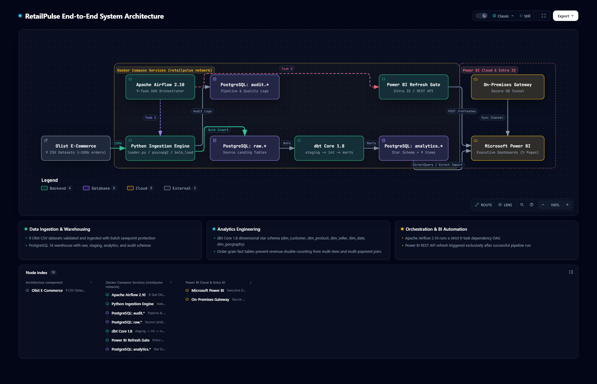
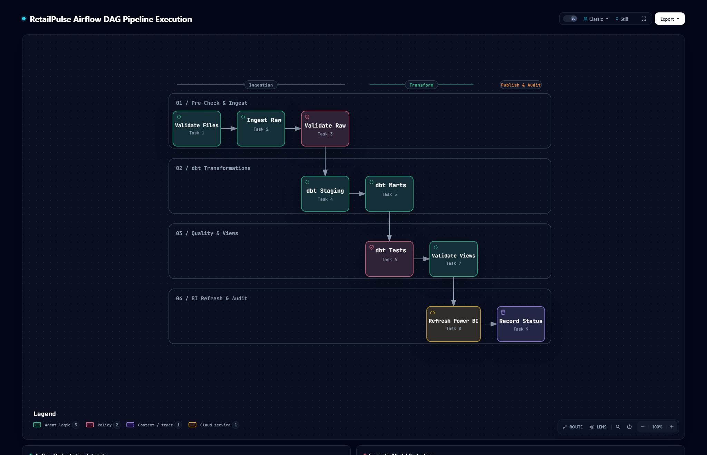
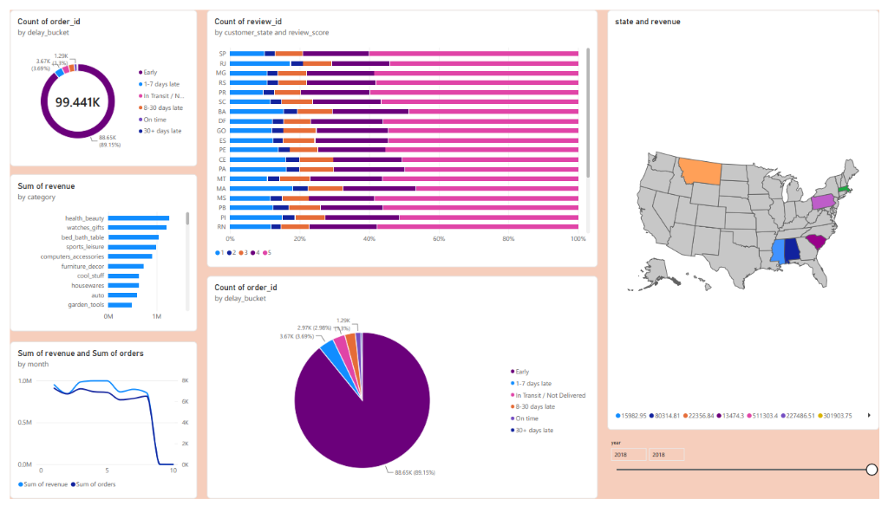

# RetailPulse — Production-Grade End-to-End Data Engineering & Retail Analytics Platform

[](https://www.python.org/)
[](https://www.postgresql.org/)
[](https://www.getdbt.com/)
[](https://airflow.apache.org/)
[](https://powerbi.microsoft.com/)
[](https://docs.docker.com/compose/)
[](https://github.com/tt-a1i/archify)
[](tests/)
[](dbt/)
[](LICENSE)

**RetailPulse** is an enterprise-grade data platform engineered on the public **Brazilian E-Commerce Dataset by Olist** (100,000 orders, ~1.55M rows). It demonstrates real-world analytics engineering: resilient bulk ingestion with PostgreSQL `SAVEPOINT` error isolation, Kimball dimensional star modeling with **dbt Core**, automated 9-task orchestration via **Apache Airflow**, least-privilege PostgreSQL security guardrails, interactive **Archify** architecture visuals, and automated **Microsoft Power BI REST API** semantic model refresh integration.

---

## Table of Contents
1. [Architecture Overview](#architecture-overview)
2. [End-to-End Airflow Orchestration Pipeline](#end-to-end-airflow-orchestration-pipeline)
3. [Power BI Executive Dashboard](#power-bi-executive-dashboard)
4. [Technology Stack](#technology-stack)
5. [Repository Structure](#repository-structure)
6. [Business Problem & Metric Guardrails](#business-problem--metric-guardrails)
7. [Database Security & Least-Privilege Roles](#database-security--least-privilege-roles)
8. [Quickstart & Setup Guide](#quickstart--setup-guide)
9. [Automated Testing & Quality Verification](#automated-testing--quality-verification)
10. [Verified Engineering Competencies](#verified-engineering-competencies)
11. [License](#license)

---

## Architecture Overview

RetailPulse decouples raw data landing, staging views, Kimball dimensional marts, and high-performance analytics reporting views into distinct schemas with strict privilege boundaries.



### Key Architectural Layers
1. **Landing Zone (`raw.*`)**: Bulk ingested CSV records with composite keys and PostgreSQL transaction savepoints for per-record error isolation without batch rollbacks.
2. **Staging Layer (`staging.*`)**: 1-to-1 typed dbt views with sanitized column naming, ISO timestamp casting, and validated null handling.
3. **Dimensional Layer (`analytics.dim_*` & `analytics.fact_*`)**: Kimball star schema models isolating orders, items, payments, customer reviews, and shipping logistics into discrete grains to prevent Cartesian inflation.
4. **Presentation Layer (`analytics.vw_*`)**: 9 curated SQL reporting views optimized for Power BI DirectQuery and scheduled import refreshes.

> **Interactive Archify Diagrams**: Self-contained interactive HTML diagrams are available in [`docs/diagrams/`](docs/diagrams/):
> - [System Architecture Diagram](docs/diagrams/system_architecture.html)
> - [Data Ingestion Flow](docs/diagrams/data_ingestion_flow.html)
> - [Warehouse Dimensional Model](docs/diagrams/data_warehouse_model.html)
> - [Airflow Pipeline DAG](docs/diagrams/airflow_pipeline.html)
> - [dbt Transformations & Tests](docs/diagrams/dbt_transformations.html)
> - [Power BI Reporting Views](docs/diagrams/powerbi_analytics_views.html)
> - [Power BI OAuth Refresh Sequence](docs/diagrams/powerbi_refresh_flow.html)
> - [Docker Deployment Architecture](docs/diagrams/deployment_architecture.html)

---

## End-to-End Airflow Orchestration Pipeline

The entire platform runs automatically through an idempotent 9-task Apache Airflow DAG (`retailpulse_pipeline`). Upstream validation and downstream tests form a hard quality gate before any business reporting views or BI semantic models are refreshed.



### Sequential Task Breakdown
| Step | Task ID | Operator | Responsibility |
| :---: | :--- | :--- | :--- |
| **T1** | `validate_source_files` | `PythonOperator` | Verifies existence, read permissions, and non-empty sizes for all 9 Olist CSV files. |
| **T2** | `ingest_raw_data` | `PythonOperator` | Streams CSV batches into `raw.*` landing tables using `execute_values` and savepoint recovery. |
| **T3** | `validate_raw_tables` | `PostgresOperator` | Validates minimum non-zero row thresholds across all raw tables before modeling begins. |
| **T4** | `dbt_staging` | `BashOperator` | Compiles and runs dbt staging models (`stg_olist_*`). |
| **T5** | `dbt_intermediate_marts` | `BashOperator` | Materializes intermediate aggregations and dimensional Kimball marts (`dim_*`, `fact_*`). |
| **T6** | `dbt_tests` | `BashOperator` | Executes 64 automated data quality checks (uniqueness, referential integrity, accepted ranges). |
| **T7** | `validate_analytics_views` | `PostgresOperator` | Runs sanity checks against all 9 presentation views in `analytics.vw_*`. |
| **T8** | `refresh_powerbi_semantic_model` | `PythonOperator` | **Gated Step**: Requests automated cloud dataset refresh via Microsoft Entra ID OAuth 2.0 & Power BI REST API only if T1–T7 succeed. |
| **T9** | `record_pipeline_status` | `PostgresOperator` | Inserts end-to-end execution metrics and completion timestamps into `audit.pipeline_runs`. |

---

## Power BI Executive Dashboard

The platform feeds directly into a multi-page **Power BI Executive Dashboard** connected to PostgreSQL via the least-privilege `powerbi_reader` role.



### Dashboard Visualizations & Business Insights
- **Order Fulfillment & Delay Buckets**: Donut and pie charts classifying 99,441 orders into delay segments (*On time: 89.15%*, *1–7 days late: 3.69%*, *8–30 days late: 2.96%*, *30+ days late: 1.29%*).
- **Customer Satisfaction by State & Review Score**: 100% stacked horizontal bar chart tracking 1-to-5 star sentiment across Brazilian states (SP, RJ, MG, RS, PR, etc.), highlighting regional fulfillment challenges.
- **Top Product Categories by Revenue**: Pareto bar visual ranking leading categories (`health_beauty`, `watches_gifts`, `bed_bath_table`, `sports_leisure`, `computers_accessories`).
- **Revenue & Order Volume Trajectory**: Dual-axis monthly run-rate trend line comparing revenue velocity against total order volume.
- **Geographic Revenue Distribution**: State-level choropleth map highlighting core markets and expansion territories.

### Production DAX Library
Comprehensive measure library implemented in [`powerbi/dax_measures.dax`](powerbi/dax_measures.dax):
```dax
// On-Time Delivery Rate
On-Time Delivery Rate % = 
DIVIDE(
    CALCULATE(COUNT(fact_orders[order_id]), fact_delivery_performance[is_delayed] = FALSE),
    COUNT(fact_orders[order_id]),
    0
)

// Month-over-Month Revenue Growth
Revenue MoM Growth % = 
VAR CurrentRev = [Total Net Revenue]
VAR PrevRev = CALCULATE([Total Net Revenue], DATEADD(dim_date[full_date], -1, MONTH))
RETURN
DIVIDE(CurrentRev - PrevRev, PrevRev, 0)
```

---

## Technology Stack

| Component | Technology | Version | Purpose |
| :--- | :--- | :--- | :--- |
| **Runtime** | Python | 3.10.11 | Ingestion engine, metadata checksums, Power BI REST client |
| **Database** | PostgreSQL | 16 (Alpine) | Schemas: `raw`, `staging`, `analytics`, `audit` |
| **Transformation** | dbt Core & dbt-postgres | 1.8.2 | Incremental Kimball star schema, 64 data quality tests |
| **Orchestration** | Apache Airflow | 2.10.3 | 9-Task sequential DAG with automated retries and alerting |
| **Business Intelligence** | Microsoft Power BI Desktop & Service | Cloud | 5-Page executive dashboard, DAX measures, REST refresh |
| **Containerization** | Docker & Docker Compose | v5.5 | Isolated network, health checks, persistent volumes |
| **Testing** | pytest & pytest-mock | 8.x | 30 unit & live database integration tests |
| **Diagrams** | Archify CLI | 3.1.0 | Dark-mode interactive HTML & high-resolution PNG diagrams |

---

## Repository Structure

```text
RetailPulse/
├── ingestion/                     # Ingestion engine & Power BI REST API refresh
│   ├── config.py                  # Dataclass configuration with env validation
│   ├── loader.py                  # Streaming bulk loader with SAVEPOINT error isolation
│   ├── ingest.py                  # Pipeline coordinator & pre-flight integrity checks
│   ├── metadata.py                # SHA-256 checksums & execution audit tracking
│   └── powerbi_refresh.py         # Microsoft Entra ID OAuth 2.0 client-credentials client
├── sql/                           # PostgreSQL DDL & security guardrails
│   ├── 00_security_and_roles.sql  # Least-privilege roles, connection throttling, timeouts
│   ├── 01_init_schemas.sql        # Schemas: raw, staging, analytics, audit
│   ├── 02_raw_tables.sql          # Source landing tables with composite keys
│   ├── 04_analytics_model.sql     # Kimball star schema facts, dimensions & indexes
│   ├── analytics_views.sql        # 9 presentation views optimized to eliminate fan-out
│   └── queries/sample_queries.sql # Executive KPIs, trend, & customer satisfaction SQL
├── dbt/                           # dbt Core transformation project
│   ├── dbt_project.yml            # Project configuration & incremental materializations
│   ├── profiles.yml               # PostgreSQL connection profile
│   ├── macros/                    # Safe timestamp parsing & normalization macros
│   └── models/
│       ├── staging/               # 1-to-1 typed staging views with null handling
│       ├── intermediate/          # Aggregated line items, reviews & delivery delays
│       └── marts/                 # Star schema facts (order, item, payment, review, delivery)
├── airflow/                       # Apache Airflow orchestration
│   ├── dags/
│   │   └── retailpulse_pipeline.py # 9-task idempotent orchestration DAG
│   └── config/                    # Airflow connection templates
├── powerbi/                       # Power BI analytics assets
│   ├── README.md                  # Gateway & Entra ID Service Principal setup guide
│   ├── views.sql                  # DirectQuery/import analytics view definitions
│   ├── dax_measures.dax           # Production DAX library for all 5 dashboard pages
│   └── dashboard_spec.md          # Visual hierarchy & layout specifications
├── tests/                         # Automated test suite (30 passing tests)
│   ├── test_config.py             # Config loading, defaults, & override validation
│   ├── test_metadata.py           # Checksums, hashing, & audit metric tracking
│   ├── test_loader.py             # CSV streaming, alias mapping, & value cleaning
│   ├── test_business_logic.py     # Fan-out prevention & on-time delivery formulas
│   ├── test_powerbi_refresh.py    # Entra ID token & HTTP error response handling
│   └── test_db_integration.py     # Live PostgreSQL schema & role permission tests
├── scripts/                       # PowerShell automation scripts
│   ├── setup.ps1                  # One-click startup & database initializer
│   └── cleanup.ps1                # Safe container teardown preserving persistent volumes
├── docs/                          # Documentation & visual assets
│   ├── assets/                    # High-resolution PNG diagrams & dashboard screenshot
│   │   ├── system_architecture.png
│   │   ├── pipeline_architecture.png
│   │   └── powerbi_dashboard.png
│   ├── diagrams/                  # Standalone interactive Archify HTML diagrams
│   └── PHASE_PLAN.md              # Milestone planning & verification record
├── docker-compose.yml             # PostgreSQL 16 + Airflow 2.10 multi-container setup
├── Dockerfile                     # Airflow container build configuration
├── requirements.txt               # Pinned Python dependencies
├── .env.example                   # Environment variable template (no credentials committed)
├── .gitignore                     # Strict exclusion of .env, data/, logs/, secrets/
└── README.md
```

---

## Business Problem & Metric Guardrails

RetailPulse transforms messy multi-file e-commerce transactions into trustworthy metrics:
1. **Sales & Orders**: Total net revenue, order volume, and Average Order Value (AOV).
2. **Growth Over Time**: Monthly revenue run-rate, MoM growth %, and seasonal trends.
3. **Product & Seller Analytics**: Category contribution, top seller fulfillment performance, and logistics bottlenecks.
4. **Customer Retention**: Repeat buyer rates and spending distribution across Brazilian federative states.
5. **Logistics & Satisfaction**: Quantifying how delivery delays suppress customer review ratings.

### Critical Revenue Guardrail: Preventing Double-Counting
In e-commerce datasets, orders contain multiple line items (`olist_order_items_dataset`) and multiple split payment tenders (`olist_order_payments_dataset` across credit cards, vouchers, and boletos).
* **The Anti-Pattern**: Joining `order_items` directly to `order_payments` produces an `M x N` Cartesian explosion, artificially inflating revenue figures by 200–300%.
* **The RetailPulse Solution**:
  - `fact_orders` holds order-level revenue strictly calculated as `SUM(item.price)`.
  - `fact_order_items` preserves item-level grain for seller and product analytics.
  - `fact_payments` maintains separate payment-level grain for installment and tender analysis.
  - Analytics views (`analytics.vw_*`) use Common Table Expressions (CTEs) to pre-aggregate line items and reviews before joining.
  - **Verified Result**: `vw_executive_kpis` reports **R$ 13,591,643.70** across 99,441 orders—matching raw item prices to the exact cent with zero Cartesian distortion.

---

## Database Security & Least-Privilege Roles

Configured in [`sql/00_security_and_roles.sql`](sql/00_security_and_roles.sql):

```text
┌───────────────────────┐      ┌─────────────────────────┐      ┌───────────────────────┐
│  retailpulse_ingest   │      │  retailpulse_transform  │      │    powerbi_reader     │
├───────────────────────┤      ├─────────────────────────┤      ├───────────────────────┤
│ INSERT, TRUNCATE on   │      │ SELECT on raw.*         │      │ Strict SELECT on      │
│ raw.*                 │      │ ALL PRIVILEGES on       │      │ analytics.vw_* only   │
│ INSERT on audit.*     │      │ staging.*, analytics.*  │      │ Zero DDL / No raw     │
└───────────────────────┘      └─────────────────────────┘      └───────────────────────┘
```

- **Resource Limits**:
  - `powerbi_reader`: Statement timeout of `60s`, idle session timeout of `30s`, connection limit of `100`.
- **Integrity Constraints**:
  - Review scores constrained between `1` and `5`.
  - Prices, freight fees, and payment values constrained to `CHECK (value >= 0)`.
  - Composite primary key `(review_id, order_id)` on `raw.olist_order_reviews_dataset` to handle survey resubmissions without row rejection.

---

## Quickstart & Setup Guide

### 1. Prerequisites
- **Python 3.10+**
- **Docker Desktop** (daemon running)
- **Git**
- **Power BI Desktop** (optional, for viewing `.pbix` dashboards)

### 2. Environment Configuration
Copy the configuration template (never commit `.env` with credentials):
```powershell
Copy-Item .env.example .env
```

### 3. Automated Setup via PowerShell
Run the automated environment initializer:
```powershell
powershell -ExecutionPolicy Bypass -File .\scripts\setup.ps1
```
The script automatically:
1. Validates Docker daemon availability.
2. Starts the PostgreSQL container via Docker Compose on port `5433` (mapped from `5432`).
3. Applies database security roles, schemas, raw tables, dimensional models, and analytics views.
4. Initializes and starts Apache Airflow at `http://localhost:8080`.

### 4. Running the Pipeline Manually
```powershell
# 1. Ingest raw CSV data into PostgreSQL
python -m ingestion.ingest

# 2. Run dbt dimensional transformations and data tests
dbt build --project-dir dbt --profiles-dir dbt

# 3. Execute automated test suite
pytest
```

---

## Automated Testing & Quality Verification

The test suite validates data ingestion, schema security, revenue calculations, and Power BI REST interactions:

```powershell
pytest -v
```

```text
tests/test_business_logic.py::test_revenue_calculation_no_payment_fanout PASSED
tests/test_business_logic.py::test_on_time_delivery_rate_formula PASSED
tests/test_business_logic.py::test_repeat_customer_rate_calculation PASSED
tests/test_business_logic.py::test_average_order_value_formula PASSED
tests/test_config.py::test_default_config PASSED
tests/test_config.py::test_env_override PASSED
tests/test_config.py::test_connection_string PASSED
tests/test_config.py::test_source_files_mapping PASSED
tests/test_config.py::test_missing_data_dir_handled PASSED
tests/test_config.py::test_invalid_port PASSED
tests/test_integration.py::test_database_connectivity_and_version PASSED
tests/test_integration.py::test_powerbi_reader_permissions_and_limits PASSED
tests/test_loader.py::test_clean_value_handles_empty_and_null PASSED
tests/test_loader.py::test_clean_value_preserves_valid_strings PASSED
tests/test_loader.py::test_resolve_column_name PASSED
tests/test_loader.py::test_stream_csv_reads_sample_file PASSED
tests/test_loader.py::test_bulk_loader_init PASSED
tests/test_loader.py::test_bulk_loader_load_missing_file PASSED
tests/test_metadata.py::test_compute_checksum PASSED
tests/test_metadata.py::test_compute_checksum_missing_file PASSED
tests/test_metadata.py::test_run_result_to_dict PASSED
tests/test_powerbi_refresh.py::test_powerbi_config_defaults PASSED
tests/test_powerbi_refresh.py::test_powerbi_config_from_env PASSED
tests/test_powerbi_refresh.py::test_powerbi_config_is_configured PASSED
tests/test_powerbi_refresh.py::test_get_access_token_success PASSED
tests/test_powerbi_refresh.py::test_get_access_token_failure PASSED
tests/test_powerbi_refresh.py::test_trigger_refresh_success PASSED
tests/test_powerbi_refresh.py::test_trigger_refresh_conflict_409 PASSED
tests/test_powerbi_refresh.py::test_trigger_refresh_rate_limit_429 PASSED
tests/test_powerbi_refresh.py::test_poll_refresh_status_completed PASSED

============================== 30 passed in 2.85s ==============================
```

- **dbt Schema Tests**: **64 / 64 passing** checks across staging, intermediate, and marts layers:
  - `unique` and `not_null` constraints on surrogate and natural primary keys.
  - `relationships` referential integrity across dimensional foreign keys.
  - `accepted_values` validation on delivery statuses, review scores (`1`–`5`), and payment methods.

---

## Verified Engineering Competencies

- **Idempotent Data Engineering**: Ingestion and dbt transformations are fully replayable; re-running tasks produces identical, deterministic analytical marts without duplicate records.
- **Kimball Dimensional Architecture**: Modeled high-performance star schema marts (`fact_orders`, `fact_order_items`, `fact_payments`, `fact_reviews`, `fact_delivery_performance`) with pre-calculated CTE aggregations to eliminate Cartesian inflation.
- **Resilient Bulk Loading**: Engineered streaming CSV parsing using `psycopg2.extras.execute_values` paired with per-record PostgreSQL `SAVEPOINT` transactions to capture error logs without aborting batch executions.
- **Production Airflow Orchestration**: Configured a 9-task dependency DAG incorporating pre-flight data checks, transformation steps, automated schema testing, and conditional downstream BI triggers.
- **Automated BI Integration**: Connected Microsoft Power BI REST API with OAuth 2.0 client credentials via Microsoft Entra ID, automating semantic model refreshes gated on passing tests.
- **Enterprise Database Security**: Established least-privilege PostgreSQL roles, query timeouts (`60s`), and connection limits (`100`) to guarantee high-concurrency warehouse isolation.

---

## License

This project is licensed under the **MIT License** — see the [LICENSE](LICENSE) file for details.
